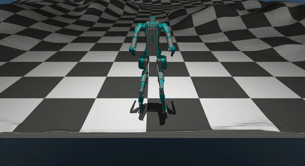

# digit_mujoco
A simulation library for Agility Robotics' Digit robot using MuJoCo (with Model Based Controller).

Thanks to Hyunyoung Jung (creator of the code) hjung331@gatech.edu



## Dependencies
- ROS1
- Mujoco ()
- Python version: 3.8+ 


## Setup

1. Create catkin workspace ()
<br />

2. Clone the repositories
```bash
. /opt/ros/ROS-VERSION/setup.bash      #source ros
cd catkin_ws/src
git clone https://github.gatech.edu/GeorgiaTechLIDARGroup/digit_mujoco.git
```
<br />

3. Setting up Python bind
```bash
cd digit_mujoco/src/digit_mujoco/
code . #open VS-code
```
Delete `build/` folder to clear old Pythonbind metadata (or manually delete it without command line)
```bash
rm -rf build/temp.linux-x86_64-3.8 #delete build folder
```

Change the string filepath in `digit_mujoco/src/digit_mujoco/DigitControlPybind/src/digitControlEnv.hpp` (Line 23)
```ruby
#digit_mujoco/src/digit_mujoco/DigitControlPybind/src/digitControlEnv.hpp (Line 23)

void init(){
    controller_ = new digitcontroller::DigitController("/home/PATH-TO/DigitControlPybind/src/include/digit_controller/src",control_dt);
 }

```


Create Python bindings for C++ code (i.e., the model based controller code for Digit) Make sure your are in the right folder when running the command below
```bash
cd /home/PATH-TO/catkin_ws/src/digit_mujoco/src/digit_mujoco
pip install -e .
```
After executing the command, you should see new `build/temp.linux-x86_64-3.8` created.

<br />

4. Build Catkin package
```bash
. /opt/ros/ROS-VERSION/setup.bash      #source ros
cd /home/PATH-TO/catkin_ws/
catkin build                           #build package
. devel/setup.bash                     #source devel folder
```

<br />

## Terrain Configuration

For Flat Ground, you can skip to next section.

To Update any sim model configuration, go to `digit_mujoco/src/digit_mujoco/models/flat/digit-v3-flat.xml`

<br />

For Custom Terrain,

In `digit_mujoco/src/digit_mujoco/models/custom/digit-v3-custom.xml`, You have to manually change the file path to your desired terrain image in xml file (Line 57)

Note: terrain image must be a grayscale **.png** file. See reference .

```ruby
#digit_mujoco/src/digit_mujoco/custom/digit-v3-custom.xml (Line 57)

   <!-- CUSTOM HEIGHT FIELD -->
   <hfield name='hf1' file= '/home/PATH-TO/digit_mujoco/src/digit_mujoco/data/srtm/raw/terrains/terrain_n16_e102.png'  nrow='0' ncol='0' size="12 12 0.4 .1"/>
 ```
<br />

## Test

1. In `digit_mujoco/src/digit_mujoco/test/digit_main.py` (Line 24)

To run PSP demo, set `PSP_flag = True`, otherwise this will default to User-Key Inputs
```ruby
#digit_mujoco/src/digit_mujoco/test/digit_main.py (Line 24)

#---------------------------
# Flags
#
PSP_flag = False
UserKeyInput_flag = not PSP_flag

#---------------------------
```

Note: You can create your own PSP-hyperparams text file, as shown in `digit_mujoco/src/digit_mujoco/log_psp_belief/psp-hyperparam-demo.txt`


To run PSP command on flat ground and not custom terrain, simply change `cfg_env.terrain.terrain_type` from **'custom'** to **'flat'** 
```ruby
#digit_mujoco/src/digit_mujoco/test/digit_main.py (Line 64)

#Example Demo of PSP 
if PSP_flag:
    cfg_env.terrain.terrain_type = 'custom'
```

<br />

2. Launch the code
```bash
cd /home/PATH-TO/catkin_ws/
. /opt/ros/ROS-VERSION/setup.bash      #source ros
. devel/setup.bash                     #source devel folder

roslaunch digit_mujoco main.launch
```
<br />

## Additional Note:
When `PSP_flag = True`, the ankle actuation is disabled. 

Please see `digit_mujoco/src/digit_mujoco/DigitControlPybind/src/include/digit_controller/src/walking_trajectory.cpp` (Line 1447).
